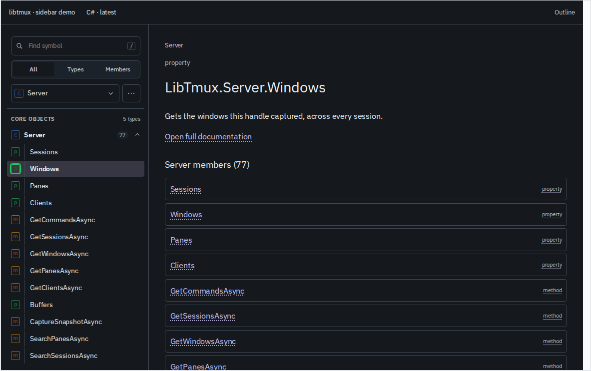
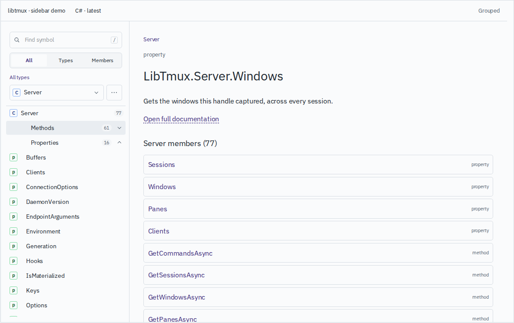
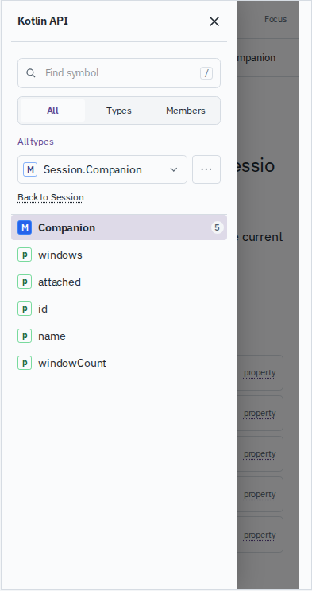
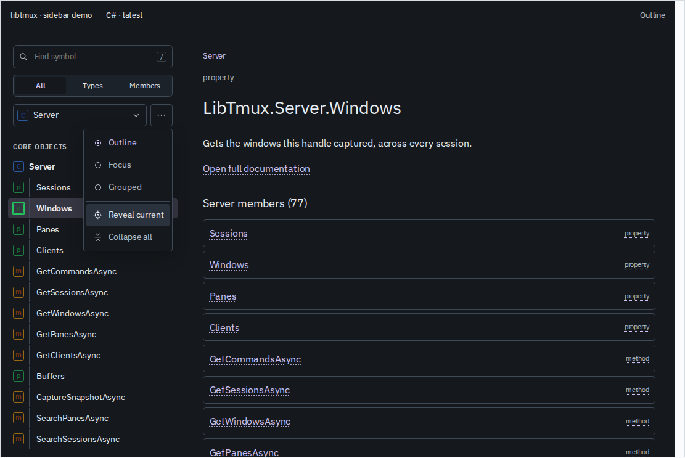
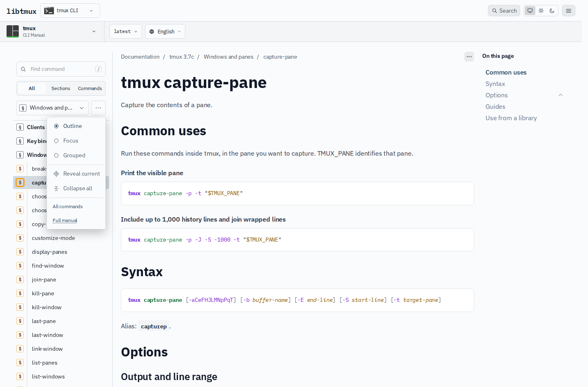

# API sidebar variants

The `/demo/sidebar/` gallery compares three presentations of the shared API
sidebar across all 16 library ports and the tmux CLI. The same layouts are
available on reference pages through the “…” menu beside the type picker.
The selected layout persists across reloads and reference pages.

- **Outline** keeps the hierarchy visible, with aligned kind marks and indented
  names. Expanding an owner exposes its members in the model's order.
- **Focus** shows one owner's members. The type picker stays available, and
  nested types link back to their enclosing type. “All types” returns to the
  complete type list.
- **Grouped** separates an owner's members by kind and sorts each group
  alphabetically. Groups can be collapsed independently.

The controls select a reference, a desktop/tablet/phone viewport, light or dark
theme, and sidebar width. The URL records the configuration and selected
declaration. Back, Forward, and reload restore it. The examples include
`Server.Windows`, `Session.Companion`, repeated names, long names, and a type
with no members; the current API models supply the inventory and counts.

The type picker opens a searchable list with kind marks and trailing kind
labels. Outline, Focus, Grouped, Reveal current, and Collapse all share the
adjacent actions menu. On reference pages it also links to the reference index
and glossary. The tmux CLI uses manual sections and commands in place of types
and members, with links to All commands and the full manual.
Standalone names repeated across receivers include that context, such as
`OptionalInt.orNull` and `OptionalLong.orNull`. Kotlin identifier escapes stay
in signatures and identities; navigation labels show the unquoted name.








## Local review

From this checkout, start the demo at <http://localhost:4382/demo/sidebar/>:

```console
$ pnpm dev --host 127.0.0.1 --port 4382
```

Astro runs the server as a background process. Stop it before restarting:

```console
$ pnpm --filter @libtmux/site exec astro dev stop
```

Run the browser matrix against the running server:

```console
$ node site/scripts/check-sidebar-demo.mjs \
    --url http://localhost:4382/demo/sidebar/
```

The full publication audit also runs this matrix. It stays separate from the
routine unit and lint loops.

## Reference and intentional differences

The reference is the [sidebar lab](https://libtmux-sidebar-lab.obj.chatgpt.site/)
at revision `c094342b0da079c5d961cd1ebd9ec7ebd810e3cd`, with no source changes.
Its local copy remains at <http://localhost:4381/> for comparison.

The integrated demo uses the docs site's fonts, colors, kind marks, and 56rem
drawer breakpoint. At 820px it uses the docs drawer; the lab uses a sidebar at
that width. The preview article shows the current model's summary and owner
members, with a link to the full documentation. It does not reproduce the lab's
captured article or partial symbol inventory.

The demo's internal URLs use the existing locale, version, and preview-root
helpers. API destinations retain their canonical default locale, including
when the gallery is viewed from another locale.
